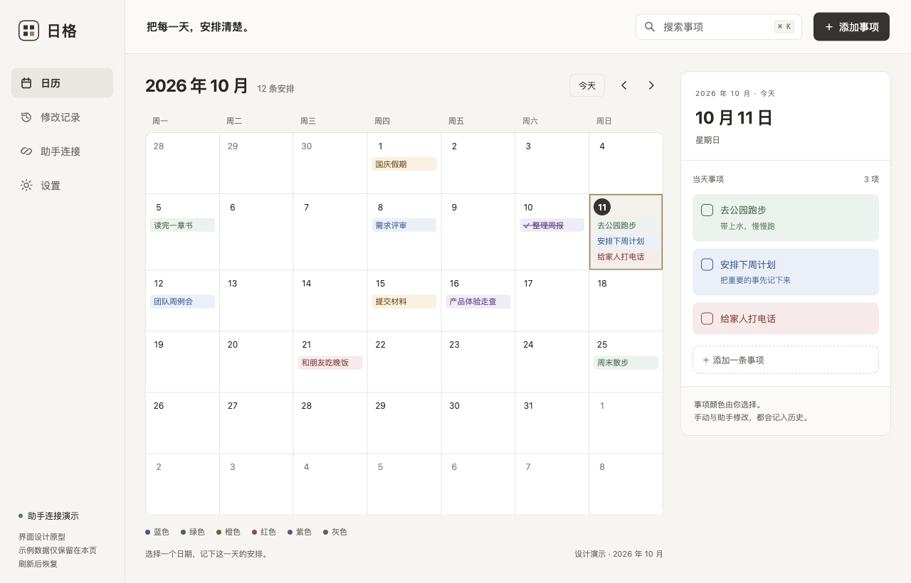

# 日格 Daygrid

**把每一天，安排清楚。** 日格是一款本地个人桌面日历：点击日期记事，为新事项自动配色，也能让外部客户端通过 MCP 读取并管理同一份日历。无需账号、云服务或模型密钥。

当前版本 **0.4.0**（开发预览）。变更见 [CHANGELOG](CHANGELOG.md)。



## 已实现

**日历**

- 月历（可选周一或周日开头）、当天面板、回到今天；跨日与回到前台及时核对日期，浏览历史日期时保留选择；浅色 / 深色 / 跟随系统。
- 标题、备注、六色事项；新建、编辑、改日期、完成与恢复未完成。
- 备注支持 Markdown，里面的网址与链接可点击，用系统浏览器打开。
- 每天标出「休」或「班」：周末、法定假日与调休补班（内置 2025–2026 年放假安排），任意一天可手动改成休息日或工作日。
- 拖拽改期、删除与改期可撤销、当天面板快速添加、键盘导航。
- 命令面板（⌘K）：跨所有日期搜索事项、输入 `10-20` / `明天` 跳转、执行常用命令。
- SQLite 持久保存、软删除、修改记录（字段级前后对比）与删除恢复。

**MCP 连接**

- 9 个 stdio MCP 工具：上下文、月概览、范围查询、按 ID 查询、新建、编辑、完成状态、删除、查询确认结果；另有 3 个资源与 2 个提示词。
- **删除必须经你确认**：助手提交后进入待确认，由你在日格里批准或拒绝，10 分钟未处理自动过期。可在设置里改为「所有写入都需确认」。
- 独立连接、只读或读写、暂停与永久撤销；每次调用都记入本机活动记录。
- 设置页一键写入 Cursor 与 Claude Desktop 配置（只增改 `mcpServers.daygrid`，首次修改前备份，无效 JSON 拒绝改写）；Claude Code 与 Codex 提供可复制命令。
- 事务内幂等回执、事项版本冲突（编辑时被改会对比差异并保留草稿）、稳定分页。

**可靠性与可观测**

- 每天首次启动自动备份、升级前自动备份、手动备份；设置页诊断与一键打开数据 / 日志 / 备份目录。
- 日志按天轮转保留 7 天，只记录操作类型、耗时与错误码，**不写入任何事项标题或备注**。

尚未实现：批量确认与事务、MCP 恢复与历史查询、备份恢复界面、全局筛选、事件订阅、时区设置、Apple 签名与公证。完整 VoiceOver 与 10000 条数据的 UI 层性能验收尚未完成。

## 安装

在 [Releases](https://github.com/kobewl/daygrid/releases) 下载 `Daygrid_x.y.z_aarch64.zip`（Apple Silicon，macOS 13+），解压后把 `Daygrid.app` 拖进「应用程序」。

这是**没有 Apple 开发者签名与公证**的个人发布包（仅 ad-hoc 签名），首次打开可能被 macOS 拦住，需要在系统设置里允许；具体入口随 macOS 版本不同，请以你系统里的界面为准。可用同名 `.sha256` 文件校验：`shasum -a 256 -c Daygrid_x.y.z_aarch64.zip.sha256`。

安装 0.2.2 后，在「设置 → 软件更新」里检查版本，发现新版时点「立即更新」。更新前自动备份，更新包验签后安装并重启；数据与 MCP 连接保留。0.2.0 / 0.2.1 没有这个入口，需要先手动安装一次。

## 本地运行

桌面构建目前验证于 **macOS Apple Silicon，macOS 13+**。需要 Xcode Command Line Tools、Rust 1.90+、Node.js 20.19+ 或 22+、pnpm 10.33.2。

```sh
pnpm install --frozen-lockfile
pnpm dev
```

`pnpm dev` 先编译并准备本地服务与 MCP 桥接，再启动 Tauri 和 React 界面。

```sh
# 构建 macOS 应用（ad-hoc 签名）
APPLE_SIGNING_IDENTITY="-" pnpm build --config '{"bundle":{"createUpdaterArtifacts":false}}'
open target/release/bundle/macos/Daygrid.app

# 仅看浏览器界面预览（示例数据，刷新后清空）
pnpm preview
```

浏览器预览会明确提示：只使用当前页面内存里的示例数据，不连接真实 SQLite、不写任何真实文件。

## 接入 MCP 客户端

1. 打开日格的「MCP 连接」，点「新建连接」，填写名称并选择只读或读写。
2. 在连接卡片里点「接入 / 配置」：Cursor 与 Claude Desktop 可以「一键写入」；Claude Code 与 Codex 复制命令到终端执行；其他客户端复制 JSON 配置。
3. 完全退出并重新打开该客户端，让它加载新的 MCP 服务器。
4. 助手先调用 `daygrid_get_context` 获取今天、时区和日历代际，然后用明确日期操作。

排查接入问题：

```sh
/Applications/Daygrid.app/Contents/MacOS/daygrid-mcp --connection <连接UUID> --check
```

它会依次检查凭据、本地服务与授权，并列出可用的工具、资源与提示词。日志在 `~/Library/Application Support/Daygrid/logs/`，可用环境变量 `DAYGRID_LOG=debug` 调整级别。

桥接程序由客户端启动，连接 UUID 只用于查找本机受保护的凭据。每次业务调用都重新检查权限；暂停后无需重启旧桥接进程即可拒绝调用。外部助手可能把读取到的日历内容发送到其模型服务。

已验证：官方 Rust SDK `rmcp 3.5.1` 客户端通过真实子进程 stdio 调用，协商协议 `2025-11-25`。当前明确只开放该协议兼容基线；各 AI 客户端的实际接入仍需逐个验证。

## 数据与架构

```text
React / Tauri ──┐
                ├── Unix Domain Socket ── daygrid-service ── SQLite
MCP stdio 桥接 ─┘
```

本地服务是数据库唯一写入者；界面和 MCP 共用校验、幂等、版本、历史与确认流程。事项只属于一个纯日期，改变时区不会移动日期。界面每 2 秒读取几个整数（`desktop_pulse`）判断是否有变化，有变化才拉取数据；窗口在后台时暂停。

macOS 数据默认在 `~/Library/Application Support/Daygrid/`。目录权限 0700，通信入口和凭据权限 0600。`DAYGRID_DATA_DIR` 可为测试指定隔离目录，桌面与桥接必须使用同一个目录。退出窗口不代表撤销助手连接；无活动调用五分钟后服务退出，后续访问按需启动。升级时会自动替换仍在运行的旧版服务。

安全边界是当前 OS 用户；持有同一用户文件访问权的进程可能读取本地数据与凭据。本版本不对外开放 HTTP 端口，也不提供任意文件或命令执行工具。

## 开发与验证

```sh
pnpm check          # 版本一致性、fmt、clippy -D warnings、前端类型检查与构建
pnpm test           # 全部 Rust 测试（含数据迁移、契约漂移、性能基线）
pnpm test:mcp       # 真实服务进程 + SDK 客户端联调
node scripts/check-version.mjs   # 版本号单一真值检查
```

`contracts/tools.json` 由代码生成；改动工具后运行 `UPDATE_CONTRACTS=1 cargo test -p daygrid --test maintenance` 更新，测试会阻止契约与实现漂移。

- [实现架构与范围](docs/architecture.md)
- [验证记录](docs/verification.md)
- [MCP 工具契约](contracts/tools.json)
- [交互设计参考](design/README.md)
- [更新日志](CHANGELOG.md)

工程结构：`apps/desktop` 桌面壳，`packages/ui` React 界面，`crates/daygrid` 领域规则、SQLite、IPC、MCP 客户端配置安装与两个可执行程序。

## 发布

发布由 GitHub Actions 完成，只认版本标签：

1. 同步修改版本号（`Cargo.toml`、`apps/desktop/tauri.conf.json`、三个 `package.json`，再 `cargo update --workspace`），并在 `CHANGELOG.md` 写好 `## [x.y.z]` 一节。
2. `node scripts/check-version.mjs vX.Y.Z` 本地先检查。
3. 提交并等 CI 变绿后：`git tag vX.Y.Z && git push origin vX.Y.Z`。

[Release 工作流](.github/workflows/release.yml)会校验版本一致、运行测试与 MCP 联调、构建应用、检查应用包（三个可执行文件、架构、版本、签名），打包 zip 与校验和、生成签名更新包与 `latest.json`，并创建 GitHub Release。发布前与线上附件回读后均用应用内置公钥验签。

发布需要仓库 Secret `TAURI_SIGNING_PRIVATE_KEY`，对应 `tauri.conf.json` 内固定的 Daygrid 更新公钥。私钥只保存在本机受限目录与 GitHub Secret，不进入仓库。现有公钥是升级信任链，不能为修复构建随意更换；普通 CI 与本地开发构建关闭 `createUpdaterArtifacts`，不读取发布私钥。

## License

[MIT](LICENSE)
